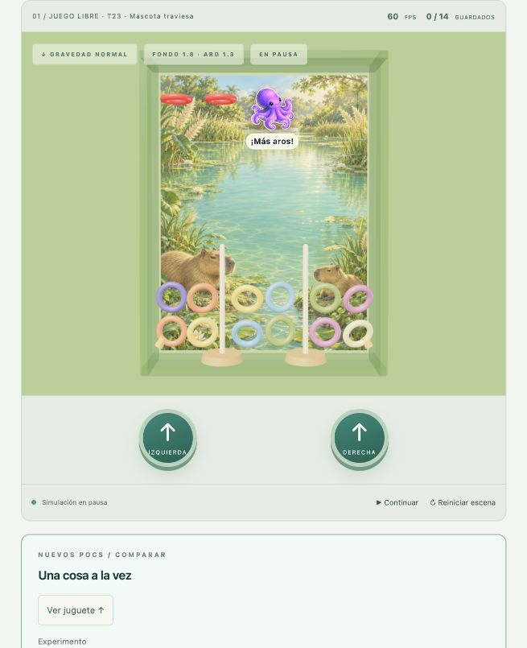

# Remaining laboratory POCs — October 20, 2026

The user authorized all remaining POC cards T13, T18, T20, T21, T22 and T23. All six are integrated as opt-in experiments in **/lab.html**, build **2005c319**. Workers used gpt-6-luna/high; the parent owns composition and evidence. Each selection restarts with its own settings and restores strength 75 / damping 0.50. Normal `/` still starts twelve free rings with the accepted geometry and no experiment controls/rewards. No production candidate has been selected.

## Candidates and how to try them

| Card | Candidate | Controls / bounded choice |
| --- | --- | --- |
| T13 | Interior widths 9, 8 and 7 (depth 1.8) | Experiment selector; same peg locations, ring size and accepted force. Free starts at narrower widths use three columns ±2.8/0 to clear shafts. |
| T18 | Twenty rings versus twelve | Same 9-wide tank. Free/stack scenes, both models/rules; stack centers separated by .35 instead of .55 for twelve. No ring shape or contact-rule change. |
| T20 | Fixed raised/offset pegs | Left base −3.8 / tip .55; right base −2.2 / tip 2.15. Physical rear supports match renderer boxes. Real collection requires threading and contact with the **same** peg's base. |
| T21 | Variable pressure | Fixed 75; explicit 37.5/75/112.5; .9-second charging on release; variable pen/touch pressure on release with an explicit level fallback. Fixed/levels pump immediately. Duration always .24 s. |
| T22 | Two mascot assists | Manual Ensartar / Dejar sobre la punta. Explicit 2-second scripted position-kinematic movement of one floor ring, then restored dynamic body. No direct scoring. “Preparar 2 aros · Guardar” uses the normal drop fixture: wait for one to collect, then assist the remaining ring. |
| T23 | Villain adds rings | Manual +1 or atomic +2, one successful encounter per round, max14. Bright red physical rings; preserved collected count, current objective updated. Free scene only; no automatic late-game enemy. |

Experiments are mutually exclusive in the UI; unsupported geometry combinations are also rejected at the configuration boundary before creating invalid bodies. Scene/model/mode changes start a fresh round but preserve the selected experiment; switching experiment restores isolated geometry and tuning. Baseline retains manual tuning controls. Camera controls and diagnostics remain laboratory-only. Theme selector provides all three painted local backgrounds/materials. The audio checkbox is opt-in and also respects saved global/music switches.

## What was measured

[Raw width comparison](lab-width-comparison.json) and `scripts/compare-lab.ts` use the same clear 12-ring 3-column fixture in every width (not each preset's ordinary free scatter), same 40 pulses and sinusoidal tilt for 20 simulated seconds, both models/rules. All 12 runs remained contained. Mean distance per starting ring for two-button/classic: width9 **38.865**, width8 **27.330**, width7 **24.910**; near-idle body samples **.09%, .41%, .40%**. With one button the distances were **12.863, 12.019, 12.187**, near-idle **28.54%, 27.14%, 27.58%**. None collected under this particular short script. These are controlled-motion observations, not evidence of greater fun or guaranteed completion. Narrowing alone did not remove the one-button idle tendency in this fixture.

Both narrower widths pass physical containment, threading, real-base collection, twelve-ring classic stack and inversion extraction. Width8 is a reasonable first manual comparison; width7 leaves a tighter side corridor beside the base (1.04 units versus a ring's 1.3 outer diameter), so feel/congestion needs user comparison. Both remain candidates, not selected defaults.

T18's four stress runs each covered **600 simulated seconds / 72,000 fixed ticks**, scripted pumps/tilt and model switching every120 simulated seconds. Results provided by the count worker:

| Initial count / mode | Wall seconds in that Node run | End state | Escapes / invalid state |
| --- | --- | --- | --- |
| 12 classic | 26.081 | 12 active / total12 | None |
| 12 collect | 28.584 | 1 saved +11 active / total12 | None |
| 20 classic | 60.949 | 20 active / total20 | None |
| 20 collect | 57.519 | 0 saved +20 active / total20 | None |

The count increase cost about twice as much engine time in those fixtures; those are not browser/mobile FPS measurements. Sparse automatic pumping did not demonstrate an enjoyment/completion improvement. Separate real-physics stack tests hold20 in classic, extract them under inversion, and collect all20 after actual contacts within60 simulated seconds. The integration initially reproduced a .34-spacing jam at16/20; .35 fixed the genuine reset fixture without changing hole/contact rules. Fourteen-ring classic capacity and stronger-pump/inversion containment were also tested for T23.

## Arcade behavior and limits

T22 is openly scripted assistance, not a proof of unassisted physical threading. Its ring remains collidable during the kinematic route; that route is not claimed as natural flow or collision-free path planning. Thread assistance conservatively needs a clear, unoccupied peg. Above assistance can release over an existing threaded pile if its target is clear; ordinary dynamics decides whether it enters. Both reject unavailable/blocked targets and affect one stable ID only. Pause freezes active ticks; restart cancels before world replacement; stale/disposed references are guarded. Usage counts reset per round. No shop, charges, automatic last-few threshold or persistent economy has been introduced.

T23 requests queue at most one manual encounter and drain before a fixed physics tick. It conservatively checks full-ring clearance against bodies/fixtures/walls and adds both requested rings or neither. No unsafe overlap or partial objective update; collected + active = current total. Duplicate/stale/paused/post-win requests are rejected. A pause cancels a still-pending request; completed additions remain real bodies. A successful addition resets classic stability. Restart removes extras and restores the initial count.

The villain reuses the locally generated painted octopus sticker with a purple CSS treatment, with a short original synthesized triangle-wave phrase in `villain-cue.ts`; no external audio/art purchases or recordings. Music ducks during the encounter and restores without restarting its phrase. Pause/mute/reset/dispose cancel cue nodes and pending activation. The helper uses the original painted octopus. Sticker-generation provenance remains in docs/art/sticker-prompts.json. A final villain design, balance, cadence and subjective acoustic acceptance remain review items.

## Verification

- Full automated suite **130/130 passed**. Direct `node node_modules/typescript/bin/tsc --noEmit`, `node --import tsx --test tests/*.test.ts`, `node build.mjs`, and `git diff --check` passed. Direct Node was used because the pnpm shim tries unavailable network metadata in these linked worktrees. Existing baseline16 engine/rule tests and600-second soak remain passing. New coverage includes corrected non-vacuous starts, raised same-base contact, twenty-ring genuine reset/victory, variable impulse/frame independence, pointer deduplication/cancel/hidden/independent sides, cue lifecycle/music ducking, both assists/blocked targets/restarts and enemy safe spawning/accounting/stale/paused/post-win/capacity.
- Browser: inspected widths7/8, raised pegs, twenty-ring objective/stack, pressure112.5 feedback, both pump models, red+1/+2 encounter counts13/14, a visible frozen villain, and theme backgrounds. T22 drop fixture naturally reached1/2, thread assistance then completed2/2 by contact; above assist was observed moving only one ring while1/2 remained, and pause froze it. New prepare/view controls make demonstrations accessible without waiting for a full round.
- Responsive desktop checks at360×800 and844×390 found no horizontal overflow. Pump buttons stay below the toy; effect captions are clamped to the viewport. Temporary viewport override was reset. This does not validate actual pressure-capable touch hardware, independent real fingers, sensors, mobile FPS or acoustic quality. Charge/pressure mappings and cancellation were automated, not tested on a real pressure sensor.
- Normal-player smoke: query parameters `scene=stack&experiment=count20` on `/` still produced0/12 free play, with no lab selector and no captured error-level logs. Laboratory effects never send normal sticker rewards.
- No paid services, deployment or push. Remaining acceptance is manual comparison of candidates, actual-device checks when free hardware is available, and subjective audio review. These gaps do not block the implemented laboratory experiments.
