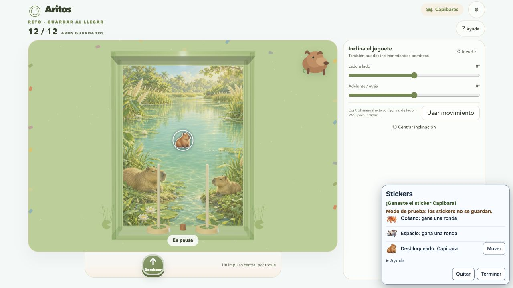

# Themed rings and earned stickers — October 20, 2026

Candidate build **a23155cf**, integrated T17/T19; workers used gpt-6-luna/high. Ready for the user's visual/play review. Normal game remains twelve physical rings, accepted 75/0.50 tuning, depth 1.8, fixed camera and both collect/classic rules. No deployment or push in this iteration.

## Player changes

Ocean rings use glossy clearcoat, space rings a metallic finish, and capybara rings a softer satin finish with the existing distinct theme palettes. Material updates retain meshes, stable IDs and pose; torus dimensions/collision holes are unchanged. No protrusions, new geometry or color scoring.

Settings → **Decorar juguete** opens the sticker collection after starting. The first genuine victory in each theme grants its one design: pulpo, nave or capibara. One instance of each can be placed on the front surface, dragged, moved with arrows or removed. Editing pauses physics and pumping, keyboard game shortcuts are suppressed, Escape/Terminar closes, and hidden/menu/restart/dispose release pointer capture. Unlocks and normalized decorative coordinates persist globally within this browser, across themes/models/reloads. No currency, account, store or round serialization. Rule decision: requirements §19.

Controlled previews have a clearly labeled **nonpersistent sandbox**. They neither load nor write the normal decorative save. A test victory can demonstrate a sticker without gifting a permanent reward. The screenshot below is explicitly this sandbox; ordinary play starts with locked rewards.

## Artwork and packaging

Three new original transparent PNG stickers were generated with the built-in `image_gen.imagegen` tool in generation mode with transparent_background=true. Exact prompts: [sticker-prompts.json](../art/sticker-prompts.json). No external stock asset or licensed recording was used. This records provenance, without claiming an exclusive copyright or separate stock license. The existing project license is unchanged. The PNG files total ~5.4 MiB and are local/fingerprinted under public/assets/stickers; build copies and hashes them and stickers.css.

Thumbnail and placed-image nodes are loaded up front and retained separately so removal/replacement requires no new image request. Cold offline startup and real mobile memory/load-time measurements remain outside this evidence.

## Verification

- Direct Node typecheck/build and git diff --check passed. The full suite passed **78/78** tests, including accepted physics tests, composition of decoration/manual/hidden pauses, material/projection checks, malformed/throwing storage fallback, normal write-once/reload, same-round theme switches, duplicate/stale/disposed events and sandbox isolation. A regression test verifies separate thumbnail/placed image ownership after removal and reuses the retained image on replacement.
- In-app browser: genuine physical stack victories reached 12/12 for ocean, space and capybaras, unlocking only the current sandbox design. Verified keyboard placement/movement, pointer drag, deletion/replacement, Escape, focus return, theme switching with a placed sticker and sandbox reset on reload. Normal player afterward showed all three rewards locked, confirming no sandbox leakage. Normal persistence is covered by feature-level storage tests, not by claiming a manual normal-round win.
- Inspected current ring finishes in all themes with two-button and single-button models; expected pumps and round counters remained consistent. This is desktop appearance evidence; finish approval is pending user feedback.
- Layout inspected at 360×640, 844×390 and normal desktop sizing. Fixed catalog overflow and kept Terminar visible with a scrolling catalog; panel leaves the toy visible. Fixed deferred focus after modal handoff and a separate-image ownership bug found during replacement. Temporary viewport override was reset. These are responsive desktop-browser checks, not real touch/sensor/device validation.
- With local HTTP server suspended after asset load, removed and replaced the capybara sticker successfully; placed image remained complete with naturalWidth 1254. Server resumed immediately. Current normal-player tab has no captured error-level console logs.
- Final tab: normal player, Space, two buttons, collect, revision a23155cf. [Current rings](evidence/aritos-themed-rings.png).

Remaining review: user's judgment of finishes/sticker scale and reward cadence, existing subjective audio review, actual Android/iOS independent-touch/sensor/FPS/load-time evidence. No paid service or deployment. T23 received a [feasibility review](enemy-feasibility.md); enemies remain planned and absent from normal play.
